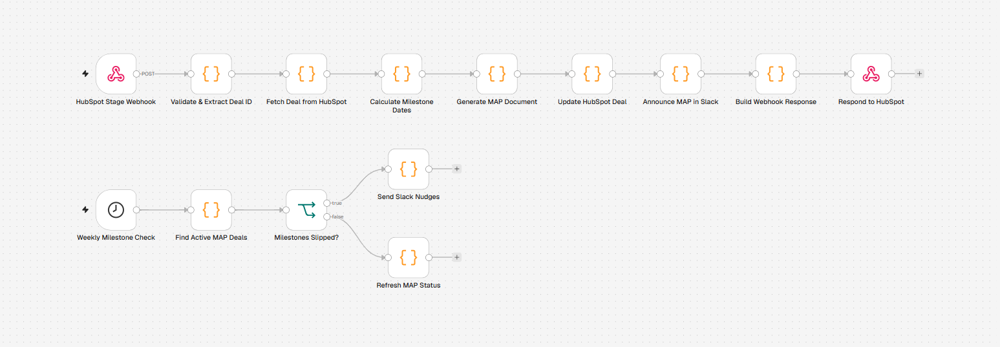

# n8n-hubspot-deal-room-mutual-action-plan-generator

When a HubSpot deal enters your **Proposal / Evaluation** stage, this automation builds a **Mutual Action Plan (MAP)** for it. Milestone dates are worked out backwards from the deal's close date, and each milestone gets a customer owner and a supplier owner. The plan is written to **Google Docs**, **Notion**, or a stub, and the MAP URL and milestone dates are synced back to the deal. Every week it checks the open milestones and sends **Slack nudges** when they slip.

I built it as an n8n workflow plus a Node.js mirror that runs the same code. The n8n Code nodes are generated from `src/core/`, and the test suite executes them against the same fixtures as the Node.js runtime, so the two can't drift apart.

Out of the box it is inert: `DRY_RUN=true`, `SANDBOX_MODE=true`, `DOC_PROVIDER=stub`, client-facing nudges off, and every credential a placeholder.

---

## Contents

1. [Architecture overview](#architecture-overview)
2. [How milestone dates are calculated](#how-milestone-dates-are-calculated)
3. [What gets written to HubSpot](#what-gets-written-to-hubspot)
4. [Prerequisites](#prerequisites)
5. [Step-by-step setup](#step-by-step-setup)
6. [n8n node configuration](#n8n-node-configuration)
7. [Environment variables](#environment-variables)
8. [Running the Node.js mirror](#running-the-nodejs-mirror)
9. [Testing](#testing)
10. [Troubleshooting](#troubleshooting)
11. [Repository layout](#repository-layout)

---

## Architecture overview



```
 HubSpot workflow (deal enters "Proposal / Evaluation")
   └─ Send a webhook  POST  x-webhook-secret: <N8N_WEBHOOK_SECRET>
          │
          ▼
 ┌──────────────────────────────── GENERATION (webhook) ───────────────────────────────┐
 │ HubSpot Stage Webhook                                                               │
 │   → Validate & Extract Deal ID   config check, shared-secret check, deal ID         │
 │   → Fetch Deal from HubSpot      deal + company + contacts + owner (v3, associations)│
 │                                  ignore: wrong stage, closed, MAP already exists     │
 │   → Calculate Milestone Dates    business-day back-scheduling from close date,       │
 │                                  holidays, compression on short runways,             │
 │                                  stakeholder roles from hs_buying_role / job title   │
 │   → Generate MAP Document        stub │ Google Docs (Drive import) │ Notion page     │
 │   → Update HubSpot Deal          map_document_url, map_status, map_<milestone>_date  │
 │   → Announce MAP in Slack        internal channel, owner @mention                    │
 │   → Build Webhook Response → Respond to HubSpot                                      │
 └─────────────────────────────────────────────────────────────────────────────────────┘

 ┌──────────────────────────────── MONITORING (weekly) ────────────────────────────────┐
 │ Weekly Milestone Check (cron, Mon 09:00)                                    │
 │   → Find Active MAP Deals        search map_status = active, evaluate each milestone │
 │   → Milestones Slipped?  ─ yes → Send Slack Nudges   internal alert (+ owner),       │
 │                          │                          optional client nudge in the     │
 │                          │                          deal's Slack Connect channel     │
 │                          └ no  → Refresh MAP Status  next milestone / completed      │
 └─────────────────────────────────────────────────────────────────────────────────────┘

 Every write passes the same interlocks:
   DRY_RUN=true      → documents, HubSpot PATCHes and Slack posts are returned, never sent
   SANDBOX_MODE=true → HubSpot writes need a sandbox/developer-test portal (or HUBSPOT_SANDBOX_PORTAL_ID);
                       documents go to the sandbox folder/database; Slack goes to the sandbox channel only
```

Each stage takes and returns plain JSON. Once a stage sets the status to `ignored` or `failed`, the later stages pass the context through untouched, so the generation branch is a straight line and still answers HubSpot with the right HTTP status.

---

## How milestone dates are calculated

The default template (override it with `MILESTONE_TEMPLATE_JSON`):

| Key | Milestone | Anchor | Business days | Lead | Customer owner role | Supplier owner role |
| --- | --- | --- | --- | --- | --- | --- |
| `kickoff` | MAP Kickoff & Success Criteria | start (today) | +2 | Joint | champion | Account Executive |
| `technical_review` | Technical Review | close date | −25 | Customer | technical | Solutions Engineer |
| `security_audit` | Security Audit | close date | −20 | Customer | security | Solutions Engineer |
| `final_proposal` | Final Proposal | close date | −15 | Supplier | economic buyer | Account Executive |
| `legal_procurement` | Legal & Procurement | close date | −8 | Customer | procurement | Deal Desk |
| `contract_signature` | Contract Signature | close date | 0 | Customer | economic buyer | Account Executive |

Rules:

1. The close date (`closedate`) is converted to a calendar date in UTC. If it falls on a weekend or holiday, it rolls back to the previous business day.
2. Close-anchored milestones count **business days backwards** from that date. Start-anchored milestones count forwards from today. Weekends and `HOLIDAYS` are skipped.
3. **Compression:** if any date would land before tomorrow, after the close date, or out of order, every milestone is spread evenly across the remaining business days (order preserved, signature on the close date). The plan is flagged `compressed`, and the document and Slack message say so.
4. A close date in the past (or missing) stops generation with `422 plan_close_date_in_past` / `plan_close_date_missing`. No document is created.
5. If fewer than `MIN_RUNWAY_BUSINESS_DAYS` remain, a `shortRunway` warning is added.

**Stakeholders** are picked from the deal's associated contacts, one per customer role. The contact's `hs_buying_role` is checked first (`CHAMPION`, `BUDGET_HOLDER`, `DECISION_MAKER`, `EXECUTIVE_SPONSOR`, `LEGAL_AND_COMPLIANCE`, `INFLUENCER`, `END_USER`), then job-title keywords (CFO/VP/Head of → economic buyer, Security/CISO → security, Procurement/Legal → procurement, Architect/Engineer/IT → technical). Anything unmatched falls back to the champion, then to "To be confirmed". The Account Executive is the deal owner. Other supplier roles use the labels in `INTERNAL_ROLE_LABELS_JSON`.

The MAP leaves out the deal amount and contact emails unless `MAP_INCLUDE_AMOUNT=true` / `MAP_INCLUDE_CONTACT_EMAILS=true`, because the document is meant to be shared with the customer.

Template format (each entry):

```json
{ "key": "pilot", "name": "Pilot Sign-off", "anchor": "close", "offsetBusinessDays": 12,
  "owner": "client", "clientRole": "technical", "internalRole": "se", "description": "Pilot success criteria met." }
```

`owner` is `client`, `internal`, or `both`. A new key needs its own `map_<key>_date` / `map_<key>_done` properties in HubSpot.

---

## What gets written to HubSpot

On generation (one `PATCH /crm/v3/objects/deals/{id}`):

| Property | Type | Value |
| --- | --- | --- |
| `map_document_url` | single-line text | Google Doc / Notion page / stub URL |
| `map_status` | dropdown (`active`, `completed`, `cancelled`) | `active` |
| `map_generated_at` | date picker (datetime) | ISO timestamp |
| `map_next_milestone` / `map_next_milestone_date` | text / date | first milestone |
| `map_slipped_milestones` | multi-line text | empty |
| `map_<key>_date` | date | `YYYY-MM-DD` for each milestone |
| `map_<key>_done` | single checkbox | `false` |

During the weekly monitor:

- `map_next_milestone`, `map_next_milestone_date`, and `map_slipped_milestones` are refreshed.
- `map_last_nudge_at` is set when an alert goes out. Alerts then pause for `NUDGE_COOLDOWN_DAYS`.
- `map_status` becomes `completed` when the deal closes or every milestone is ticked done.

Reps mark progress by ticking the `map_<key>_done` checkboxes on the deal (a good fit for a deal-record property group or a sidebar card). To get customer nudges, paste the deal's Slack Connect channel ID into `map_slack_connect_channel_id`.

---

## Prerequisites

- n8n 1.x (self-hosted or cloud) with environment access for Code nodes, **or** Node.js 20+ for the mirror. The mirror has no npm dependencies.
- A HubSpot **developer test account or sandbox** for setup, plus a Private App with these scopes:
  - `crm.objects.deals.read`, `crm.objects.deals.write`
  - `crm.objects.contacts.read`, `crm.objects.companies.read`
  - `crm.objects.owners.read`
  - `crm.schemas.deals.write` (only for the one-time property creation below)
- Optional: a Slack app with `chat:write` (bot token) or incoming webhooks; a Google Cloud service account with the Drive API enabled; a Notion internal integration.

---

## Step-by-step setup

### 1. Run it offline first

```bash
git clone https://github.com/dhrobinsystems/n8n-hubspot-deal-room-mutual-action-plan-generator.git
cd n8n-hubspot-deal-room-mutual-action-plan-generator
npm test            # 31 tests, no network
npm run simulate    # three webhook fixtures: normal, short runway (compressed), past close date
npm run preview     # the generated MAP as Markdown
npm run monitor     # weekly monitor against fixtures/sample-active-deals.json
```

The simulation fixes "today" at `SIMULATE_TODAY` (default `2026-11-16`) so the dates are reproducible. The webhook fixtures carry an `offline` block (company, owner, contacts), which is used only while the HubSpot token is a placeholder. Real HubSpot payloads don't need it.

### 2. Create the HubSpot properties (in the sandbox first)

```bash
export HUBSPOT_PRIVATE_APP_TOKEN=your_hubspot_private_app_token_here
API=https://api.hubapi.com
GROUP=mutual_action_plan
hs() { curl -sS -X POST "$API$1" -H "Authorization: Bearer $HUBSPOT_PRIVATE_APP_TOKEN" -H "Content-Type: application/json" -d "$2"; echo; }

hs /crm/v3/properties/deals/groups '{"name":"'"$GROUP"'","label":"Mutual Action Plan","displayOrder":-1}'
hs /crm/v3/properties/deals '{"name":"map_document_url","label":"MAP Document URL","type":"string","fieldType":"text","groupName":"'"$GROUP"'"}'
hs /crm/v3/properties/deals '{"name":"map_status","label":"MAP Status","type":"enumeration","fieldType":"select","groupName":"'"$GROUP"'","options":[{"label":"Active","value":"active","displayOrder":0},{"label":"Completed","value":"completed","displayOrder":1},{"label":"Cancelled","value":"cancelled","displayOrder":2}]}'
hs /crm/v3/properties/deals '{"name":"map_generated_at","label":"MAP Generated At","type":"datetime","fieldType":"date","groupName":"'"$GROUP"'"}'
hs /crm/v3/properties/deals '{"name":"map_last_nudge_at","label":"MAP Last Nudge At","type":"datetime","fieldType":"date","groupName":"'"$GROUP"'"}'
hs /crm/v3/properties/deals '{"name":"map_next_milestone","label":"MAP Next Milestone","type":"string","fieldType":"text","groupName":"'"$GROUP"'"}'
hs /crm/v3/properties/deals '{"name":"map_next_milestone_date","label":"MAP Next Milestone Date","type":"date","fieldType":"date","groupName":"'"$GROUP"'"}'
hs /crm/v3/properties/deals '{"name":"map_slipped_milestones","label":"MAP Slipped Milestones","type":"string","fieldType":"textarea","groupName":"'"$GROUP"'"}'
hs /crm/v3/properties/deals '{"name":"map_slack_connect_channel_id","label":"MAP Slack Connect Channel ID","type":"string","fieldType":"text","groupName":"'"$GROUP"'"}'

while IFS='|' read -r key label; do
  hs /crm/v3/properties/deals '{"name":"map_'"$key"'_date","label":"MAP '"$label"' Date","type":"date","fieldType":"date","groupName":"'"$GROUP"'"}'
  hs /crm/v3/properties/deals '{"name":"map_'"$key"'_done","label":"MAP '"$label"' Done","type":"bool","fieldType":"booleancheckbox","groupName":"'"$GROUP"'","options":[{"label":"Yes","value":"true","displayOrder":0},{"label":"No","value":"false","displayOrder":1}]}'
done <<'PROPS'
kickoff|Kickoff
technical_review|Technical Review
security_audit|Security Audit
final_proposal|Final Proposal
legal_procurement|Legal & Procurement
contract_signature|Contract Signature
PROPS
```

A `409` means the property already exists.

### 3. Find your stage ID

```bash
curl -sS "$API/crm/v3/pipelines/deals" -H "Authorization: Bearer $HUBSPOT_PRIVATE_APP_TOKEN"
```

Put the internal ID of your "Proposal / Evaluation" stage into `TRIGGER_STAGE_IDS` (comma-separate several pipelines' stages). The default, `presentationscheduled`, is only a stand-in from HubSpot's default pipeline.

### 4. Choose a document provider

- **`stub`** (default): no document is created, and the deal gets `STUB_DOC_BASE_URL/deal-<id>`. Use it to test the CRM and Slack flow.
- **`google_docs`**: create a service account, enable the Drive API, download its JSON key, and put the whole JSON in `GOOGLE_SERVICE_ACCOUNT_JSON`. Share the target folder (and the sandbox folder) with the service account's `client_email` as Editor. The MAP is uploaded as HTML and converted to a Google Doc. On a Shared Drive, add the service account as a member.
- **`notion`**: create an internal integration, share the target database (and the sandbox database) with it, and set `NOTION_API_TOKEN`, `NOTION_DATABASE_ID`, `NOTION_SANDBOX_DATABASE_ID`, and the database's title property name (`NOTION_TITLE_PROPERTY`, usually `Name`).

### 5. Import the n8n workflow

1. **Workflows → Import from File** → `n8n-workflow-deal-room-map.json`.
2. On the n8n host, set `NODE_FUNCTION_ALLOW_BUILTIN=crypto`, `N8N_BLOCK_ENV_ACCESS_IN_NODE=false`, and the variables from `.env.example` (keep `DRY_RUN=true` and `SANDBOX_MODE=true`). Restart n8n.
3. Copy the webhook's test URL (`/webhook-test/deal-room-map`) and production URL (`/webhook/deal-room-map`).

### 6. Create the HubSpot workflow

In the sandbox portal, create a **deal-based workflow**:

- **Enrollment trigger:** Deal stage is your Proposal / Evaluation stage (allow re-enrollment if deals can move back and forth).
- **Action:** *Send a webhook* → `POST` to the n8n production URL. Under authentication, add an API key sent as the header `x-webhook-secret` (or whatever you set in `WEBHOOK_SECRET_HEADER`) with the value of `N8N_WEBHOOK_SECRET`. Check the exact options in your portal: HubSpot has changed this action's settings over time.

The workflow re-fetches the deal from the API, so the webhook body only needs the deal ID (`objectId` or `hs_object_id`). Classic workflow payloads (`{ "objectId": 123, "properties": { ... } }`) and app-webhook event arrays both work.

### 7. Dry run, then sandbox, then production

1. **Dry run.** Move a test deal into the stage and check the n8n execution: the `Build Webhook Response` output lists the milestones and the exact property payload that would have been sent.
2. **Sandbox live.** Set `DRY_RUN=false` with `SANDBOX_MODE=true`, the sandbox token, the sandbox folder/database, and `SLACK_SANDBOX_CHANNEL_ID` (or `SLACK_SANDBOX_WEBHOOK_URL`). Confirm the document, the deal properties, and the Slack message.
3. **Production.** Point the tokens and IDs at production and set `SANDBOX_MODE=false`. Enable `CLIENT_NUDGES_ENABLED` only after reading a few internal alerts and agreeing the tone with the account teams.

---

## n8n node configuration

| Node | Type | What it does |
| --- | --- | --- |
| Read Me | Sticky Note | Setup reminders |
| HubSpot Stage Webhook | Webhook v2, `POST /deal-room-map`, respond via node | Receives the HubSpot workflow webhook |
| Validate & Extract Deal ID | Code | `ingestMapStage`: config validation, shared-secret check, deal ID extraction |
| Fetch Deal from HubSpot | Code | `loadDealStage`: deal, company, contacts, owner; stage/closed/duplicate guards |
| Calculate Milestone Dates | Code | `planStage`: back-scheduling, compression, stakeholder resolution, MAP model |
| Generate MAP Document | Code | `documentStage`: stub, Google Docs, or Notion (dry-run/sandbox aware) |
| Update HubSpot Deal | Code | `crmSyncStage`: MAP URL, status, per-milestone dates |
| Announce MAP in Slack | Code | `notifyMapStage`: internal announcement with owner mention |
| Build Webhook Response | Code | `finalizeMapStage`: status, milestones, document, CRM, Slack outcome |
| Respond to HubSpot | Respond to Webhook | JSON body, status `{{$json.httpStatus}}` |
| Weekly Milestone Check | Schedule Trigger, cron `0 9 * * 1` (edit in the node) | Starts the monitor |
| Find Active MAP Deals | Code | `monitorCollectStage`: paged search, evaluation, one item per deal |
| Milestones Slipped? | IF v2 | `slipped.length > 0` |
| Send Slack Nudges / Refresh MAP Status | Code | `monitorActStage`: alerts, client nudges, property refresh, completion |

Implementation notes:

- **No n8n credentials.** Every token comes from `$env`, and HTTP calls go through `this.helpers.httpRequest` inside the Code nodes. That keeps the dry-run and sandbox interlocks in one place. If you prefer n8n's native HubSpot/Slack nodes and credential store, use the Code node outputs (`crm.properties`, the Slack message) as their inputs.
- **Generated code.** Don't edit Code nodes by hand: change `src/core/`, run `npm run build:workflow`, and re-import. The tests fail if the committed JSON differs from a fresh build. Each Code node embeds the full core library (about 65 KB), which is why the file is large.
- **Privacy.** The workflow setting `saveDataSuccessExecution: none` keeps contact details out of the execution list. Failed executions are saved for debugging; prune them on a schedule.
- **Schedule timezone.** The cron runs in the workflow's timezone setting (or the instance default). The milestone math itself is in UTC calendar dates.

---

## Environment variables

| Variable | Default | Purpose |
| --- | --- | --- |
| `DRY_RUN` | `true` | Return documents, deal updates, and Slack messages instead of sending them |
| `SANDBOX_MODE` | `true` | Restrict live writes to sandbox HubSpot, sandbox folder/database, sandbox Slack |
| `PORT` / `WEBHOOK_PATH` / `WEBHOOK_MAX_BODY_BYTES` | `3000` / `/webhooks/deal-stage` / `262144` | Node.js server |
| `ADMIN_API_TOKEN` | placeholder | Bearer token for `POST /monitor/run` (24+ chars; placeholder disables it) |
| `N8N_WEBHOOK_SECRET` / `WEBHOOK_SECRET_HEADER` | placeholder / `x-webhook-secret` | Shared secret sent by the HubSpot workflow (required live) |
| `TRIGGER_STAGE_IDS` | `presentationscheduled` | Deal stages that start a MAP |
| `REGENERATE_EXISTING_MAP` | `false` | Rebuild even if an active MAP exists (a payload can also send `"force": true`) |
| `HOLIDAYS` | sample US dates in `.env.example` (empty if unset) | `YYYY-MM-DD` list skipped by business-day math |
| `MIN_RUNWAY_BUSINESS_DAYS` | `5` | Short-runway warning threshold |
| `MILESTONE_TEMPLATE_JSON` | built-in template | Custom milestones |
| `DOC_PROVIDER` | `stub` | `stub`, `google_docs`, `notion` |
| `SELLER_COMPANY_NAME` | `Your Company` | Shown in the MAP title and owner columns |
| `MAP_INCLUDE_AMOUNT` / `MAP_INCLUDE_CONTACT_EMAILS` | `false` / `false` | Customer-facing content toggles |
| `STUB_DOC_BASE_URL` | `https://docs.example.com/maps` | Stub URL prefix |
| `INTERNAL_ROLE_LABELS_JSON` | — | Labels for `se`, `deal_desk`, or custom internal roles |
| `GOOGLE_SERVICE_ACCOUNT_JSON` / `GOOGLE_DRIVE_FOLDER_ID` / `GOOGLE_SANDBOX_FOLDER_ID` / `GOOGLE_DRIVE_SCOPE` | placeholders / `drive.file` | Google Docs provider |
| `NOTION_API_TOKEN` / `NOTION_DATABASE_ID` / `NOTION_SANDBOX_DATABASE_ID` / `NOTION_TITLE_PROPERTY` / `NOTION_API_VERSION` | placeholders / `Name` / `2022-06-28` | Notion provider |
| `HUBSPOT_PRIVATE_APP_TOKEN` | placeholder | Private App token (placeholder = offline mode) |
| `HUBSPOT_PORTAL_ID` / `HUBSPOT_SANDBOX_PORTAL_ID` | placeholders | Deal links in Slack / sandbox portal pin |
| `HUBSPOT_BASE_URL` / `HUBSPOT_APP_BASE_URL` | `https://api.hubapi.com` / `https://app.hubspot.com` | API and UI hosts (EU portals may use `app-eu1.hubspot.com`) |
| `SLACK_BOT_TOKEN` / `SLACK_CHANNEL_ID` / `SLACK_WEBHOOK_URL` | placeholders | Internal channel (bot token + channel, or webhook) |
| `SLACK_SANDBOX_CHANNEL_ID` / `SLACK_SANDBOX_WEBHOOK_URL` | placeholders | Required targets while `SANDBOX_MODE=true` |
| `OWNER_SLACK_MAP_JSON` | `{}` | HubSpot owner ID → Slack user ID for mentions |
| `ANNOUNCE_NEW_MAPS` | `true` | Post when a MAP is created |
| `CLIENT_NUDGES_ENABLED` | `false` | Post client nudges into the deal's Slack Connect channel (needs a bot token) |
| `NUDGE_COOLDOWN_DAYS` / `DUE_SOON_BUSINESS_DAYS` / `MONITOR_MAX_DEALS` | `6` / `3` / `500` | Monitor tuning |
| `SIMULATE_TODAY` | `2026-11-16` | Fixed date for offline simulation and the offline monitor |

---

## Running the Node.js mirror

```bash
cp .env.example .env      # still dry run + sandbox
npm start
# POST http://localhost:3000/webhooks/deal-stage   (same payload and header as the n8n webhook)
# POST http://localhost:3000/monitor/run           (Authorization: Bearer $ADMIN_API_TOKEN)
# GET  http://localhost:3000/healthz
```

For the weekly monitor without n8n, I schedule the CLI with cron:

```cron
0 9 * * 1  cd /opt/map-generator && /usr/bin/node src/index.js --monitor >> logs/monitor.log 2>&1
```

With a placeholder HubSpot token, `--monitor` runs against `fixtures/sample-active-deals.json` and `SIMULATE_TODAY`. With a real token it searches HubSpot and uses the real date.

---

## Testing

```bash
npm test
```

`tests/map.test.js` (31 tests) covers:

- **Config:** safe defaults, live-mode refusals, holiday and template validation.
- **Dates:** business-day math, holidays, weekend close dates, compression, past and missing close dates.
- **Stakeholders:** roles from `hs_buying_role`, job titles, and fallbacks; customer-facing privacy toggles.
- **Rendering:** Markdown, HTML (escaped), and Notion blocks.
- **Document providers:** stub and dry run make zero calls; Notion writes to the sandbox database; Google Docs uses a signed service-account JWT and a multipart upload into the sandbox folder.
- **HubSpot:** dry-run interception, sandbox account-type check, deal bundle with associations, paged search.
- **Slack:** dry run, sandbox redirect (including client nudges), invalid channels, and non-Slack webhook hosts refused.
- **Generation pipeline:** deal-ID shapes, webhook secret, ignored and failed paths, a live sandbox write with request inspection.
- **Monitor:** slipped / due-soon / next evaluation, cooldown, completion on closed deals, client nudges only when enabled.
- **HTTP server:** health, webhook, admin-guarded monitor, `413`.
- **n8n parity:** structure, both triggers, credential scan, rebuild equality, and execution of the real Code nodes for both branches compared with the Node.js mirror.

---

## Troubleshooting

| Symptom | Likely cause and fix |
| --- | --- |
| Response `401 invalid_webhook_secret` | The header name or value in the HubSpot webhook action doesn't match `WEBHOOK_SECRET_HEADER` / `N8N_WEBHOOK_SECRET`. |
| `500 config_invalid` | Live mode with placeholders. The response's `errors` array lists every missing setting. |
| `ignored` / `stage_not_targeted` | `TRIGGER_STAGE_IDS` holds a stage label instead of the internal stage ID. |
| `ignored` / `map_already_exists` | The deal already has an active MAP. Set `REGENERATE_EXISTING_MAP=true` or send `"force": true` to rebuild. |
| `422 plan_close_date_in_past` | The close date is today or earlier. Update it in HubSpot and move the deal back into the stage. |
| `503 hubspot_read_sandbox_account_required` / write equivalent | `SANDBOX_MODE=true` with a production token. Use the sandbox token, or pin `HUBSPOT_SANDBOX_PORTAL_ID`. |
| `hubspot_write_http_400` | A `map_*` property doesn't exist or has the wrong type. Re-run the property script. Date properties must be *date* type, checkboxes *bool*. |
| `document_google_create_failed` with 403/404 | The folder isn't shared with the service account, or `drive.file` can't reach it. Share it as Editor, or set `GOOGLE_DRIVE_SCOPE=https://www.googleapis.com/auth/drive`. |
| `document_notion_create_failed` with 400/404 | The database isn't shared with the integration, or `NOTION_TITLE_PROPERTY` doesn't match the title column. |
| Slack `slack_sandbox_target_missing` | `SANDBOX_MODE=true` with no `SLACK_SANDBOX_CHANNEL_ID` (plus bot token) or `SLACK_SANDBOX_WEBHOOK_URL`. |
| Slack `not_configured` | Channel IDs must look like `C…`/`G…`, and webhook URLs must start with `https://hooks.slack.com/`. |
| No owner mention | Add the HubSpot owner ID → Slack user ID pair to `OWNER_SLACK_MAP_JSON`. |
| Client nudge `disabled` / `no_shared_channel` | Set `CLIENT_NUDGES_ENABLED=true` and fill `map_slack_connect_channel_id` on the deal. |
| Code node error `Cannot find module 'crypto'` | Set `NODE_FUNCTION_ALLOW_BUILTIN=crypto` and restart n8n. |
| Code node error about `$env` access | Set `N8N_BLOCK_ENV_ACCESS_IN_NODE=false`. |
| `this.helpers.httpRequest is not a function` | Your n8n version or task-runner setup doesn't expose the helper in Code nodes. Use the Node.js mirror, or upgrade n8n. |
| Milestones on public holidays | Add your region's dates to `HOLIDAYS`. The default list is only a sample. |

---

## Repository layout

```
.
├── README.md
├── LICENSE
├── DISCLAIMER.md
├── .env.example
├── .gitignore
├── package.json
├── n8n-workflow-deal-room-map.json      # generated, importable n8n workflow (both branches)
├── scripts/
│   └── build-workflow.js                # regenerates the workflow from src/core/
├── src/
│   ├── index.js                         # HTTP server, --simulate, --preview, --monitor
│   └── core/                            # shared by Node.js and n8n (embedded into Code nodes)
│       ├── config.js                    # env loader, fail-safe flags, milestone template, validation
│       ├── milestones.js                # business-day math, back-scheduling, stakeholders, evaluation
│       ├── mapDocument.js               # MAP model, Markdown/HTML/Notion renderers, providers
│       ├── hubspot.js                   # deal bundle, active-MAP search, guarded PATCH
│       ├── slack.js                     # messages and guarded sender
│       └── pipeline.js                  # generation and monitoring stages
├── fixtures/
│   ├── sample-hubspot-webhook.json
│   ├── sample-hubspot-webhook-short-runway.json
│   ├── sample-hubspot-webhook-past-close.json
│   └── sample-active-deals.json
└── tests/
    └── map.test.js
```

---

## ⚠️ Disclaimer & Liability Limitation

**Use at your own risk.** The code, workflows, and scripts provided in this repository (`n8n-hubspot-deal-room-mutual-action-plan-generator`) are for educational and architectural demonstration purposes.

* **No Liability:** The author and dhRobin Systems assume no responsibility or liability for any direct, indirect, incidental, or consequential damages resulting from the use, misuse, or deployment of these scripts, including API rate limits, data synchronization errors, CRM state discrepancies, or third-party service outages.
* **No Warranty:** All software, n8n JSON blueprints, and JavaScript modules are provided "AS IS" without warranty of any kind, express or implied, including but not limited to merchantability, fitness for a particular purpose, or non-infringement.
* **Production Testing Required:** Always test thoroughly in an isolated staging environment (for example a HubSpot developer test account or sandbox) with `SANDBOX_MODE=true` and `DRY_RUN=true` enabled before connecting live HubSpot credentials. Review every generated plan before it reaches a customer, and treat every property update and customer-facing message as irreversible.
* **Third-Party APIs & Compliance:** Users are solely responsible for complying with the terms of service, rate limits, data privacy regulations (GDPR/CCPA), and security policies of HubSpot, Google, Notion, Slack, and any connected services. That includes confirming a lawful basis for putting customer contacts' names and titles into shared documents, controlling who can open each plan and who sits in each Slack channel, and reviewing every automated nudge before enabling client-facing messages.

The full disclaimer is also available in [DISCLAIMER.md](https://github.com/dhrobinsystems/n8n-hubspot-deal-room-mutual-action-plan-generator/blob/main/DISCLAIMER.md).

## License

Released under the MIT License. Copyright (c) 2026 DH Robin (dhRobin Systems). See [LICENSE](https://github.com/dhrobinsystems/n8n-hubspot-deal-room-mutual-action-plan-generator/blob/main/LICENSE).

Licensed under the MIT License. License: MIT © 2026 dhRobin Systems · Provided as-is, see the disclaimer.
